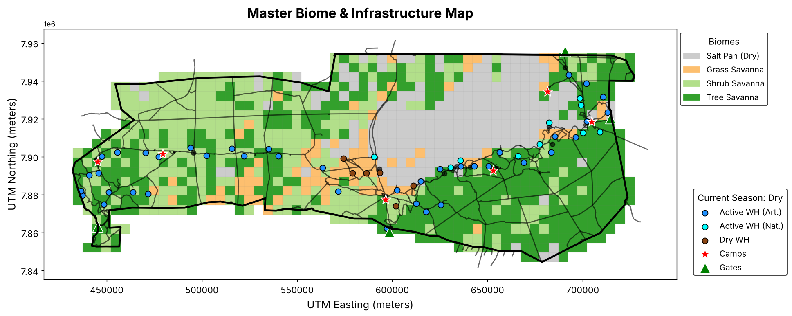

# Etosha Protection Simulator: PMMC 2026

The code behind Team ISL's submission to the **Pakistan Mathematical Modeling Challenge (PMMC) 2026**, which won a 🥇 **Gold Medal**.

The model splits Etosha National Park (Namibia) into a 5 km × 5 km grid and decides how to spend a fixed conservation budget. It places anti-poaching assets, firebreaks and habitat interventions so that as much poaching and wildfire risk as possible is removed per dollar spent.

<p align="center">
  
</p>

| | |
|---|---|
| **Coded by** | [@agenth1tman](https://github.com/agenth1tman) (team lead) |
| **Designed by** | [@saadwaslost](https://github.com/saadwaslost) |
| **Language** | Python 3 (GeoPandas, Rasterio, NumPy, Matplotlib) |

---

## What the model does

1. **Builds the grid.** The park boundary (WDPA) is projected to UTM 33S (EPSG:32733) and cut into 996 cells of 5 km × 5 km.
2. **Describes every cell** by its distance to water, roads, camps, the salt pan and the park fence, its biome (hand-digitised), its forage quality from MODIS NDVI and its moisture from MODIS NDMI (NIR/SWIR), for both the wet and the dry season.
3. **Scores animal presence (APS)** from water, forage, minerals and GPS-collar sightings, then turns it into a **poaching threat score** together with fence and road proximity.
4. **Optimises a $2,000,000 budget.** 10% is held in reserve and the rest is split 80/10/10 across:
   - **Security**: 4×4 jeeps are pre-deployed at camps, then a greedy benefit-cost optimiser places foot patrols, extra jeeps, drones and camera traps, using a detection × interdiction catch probability.
   - **Wildfire**: management zones are ranked by asset value and fire threat (NDVI/NDMI condition indices), and firebreaks are bought in priority order.
   - **Terrain**: a greedy optimiser chooses between mineral blocks, controlled burns and opening or closing artificial waterholes. A conservation constraint keeps the total animal presence across the park fixed, so animals are moved around, not created.
5. **Reports the protection score φ**, where `φ = 1 − R_total`. `R_total` is the λ-weighted share of baseline poaching and fire risk that remains after mitigation.

Sensitivity analyses on λ and on the budget split are included.

## Getting started

```bash
git clone https://github.com/agenth1tman/Pakistan-Mathematical-Modeling-Challenge.git
```

```bash
cd Pakistan-Mathematical-Modeling-Challenge
```

```bash
pip install -r requirements.txt
```

```bash
python main.py
```

Loading the data and rasters takes about 20 seconds. After that an interactive menu opens:

```
--- ETOSHA SIMULATOR (Season: Dry) ---
1: Heatmaps          | 2: Other Maps
3: Manual Generation | 4: Toggle Season
5: Run Simulation    | 6: Analysis
0: Exit
```

- Run **5: Run Simulation** first. Maps that show optimisation results (risk, threat, deployments, firebreaks, collars, minerals) need it. A full run takes about 5 minutes.
- **4: Toggle Season** switches between wet and dry season inputs (seasonal waterholes, NDVI/NDMI, salt-pan flooding, response times).
- **3: Manual Generation** opens the click-to-edit tools that were used to digitise biomes, zones and landmark coordinates.
- Figures and analysis CSVs are written to `results/`.

## Repository layout

```
.
├── main.py                 # the whole model + interactive menu
├── requirements.txt
├── data/
│   ├── boundary/           # WDPA park boundary shapefile
│   ├── rasters/            # MODIS NDVI, NIR and SWIR GeoTIFFs (wet/dry/min/max)
│   ├── etosha_roads.geojson
│   ├── etosha_camps.csv, etosha_gates.csv, etosha_waterholes.csv   # pixel coordinates from the park map
│   ├── manual_biomes.csv, manual_zones.csv                         # hand-digitised per-cell data
│   ├── routing_*.csv       # cached jeep response times (regenerate via menu 3 → 3)
│   └── legacy/             # early-stage data, not used by main.py
├── assets/                 # reference maps and README figures
└── results/                # generated figures and sensitivity results
```

## Data sources

| Data | Source |
|---|---|
| Park boundary | UNEP-WCMC and IUCN (2026), *Protected Planet: The World Database on Protected Areas (WDPA)* [On-line], March 2026, Cambridge, UK: UNEP-WCMC and IUCN. Available at: [protectedplanet.net/884](https://www.protectedplanet.net/884) |
| Roads | © [OpenStreetMap](https://www.openstreetmap.org/copyright) contributors, available under the ODbL, exported with [overpass-turbo](https://overpass-turbo.eu) |
| NDVI, NIR and SWIR | NASA MODIS products, extracted with [NASA Earthdata AppEEARS](https://appeears.earthdatacloud.nasa.gov/) |
| Camps, gates and waterholes | Digitised by hand from the official [Etosha National Park map](https://www.etoshanationalpark.org/media/Etosha-Map-2025.jpg) |
| Biomes | Digitised by hand from the study-area map in [this ResearchGate figure](https://www.researchgate.net/figure/Map-of-the-study-area-Etosha-National-Park-Namibia-The-locations-of-sampling-sites_fig1_318895272) |

The two reference maps in `assets/` belong to their original publishers and are included only as a reference for the digitisation.

## License

The code is released under the [MIT License](LICENSE). The third-party data keeps its original license (WDPA terms of use, ODbL for OpenStreetMap data, NASA data policy).
